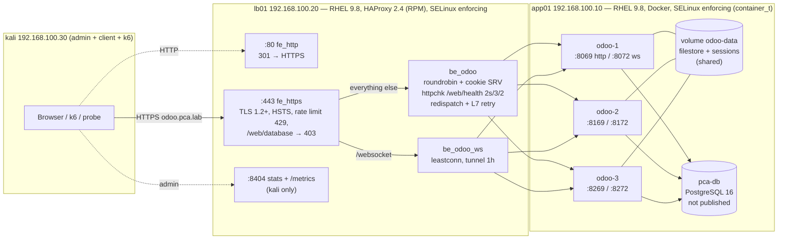

# PCA mini-projet 3 — Odoo HA behind a load balancer (lab)

The load balancer (HAProxy) brings five measurable benefits to an ERP platform covered by an
ISO 22301 continuity management system (SMCA): **availability**, **maintenance without downtime**,
**scalability**, **security at the edge** and **observability**. This repository is the single source of truth:
every config file and script lives here and is deployed to the VMs with `scp`/`ssh`.

- Measured results: [`RESULTS.md`](RESULTS.md)
- Link to continuity objectives (RTO / RPO / availability) and residual risks: [`SMCA-MAPPING.md`](SMCA-MAPPING.md)
- Jury Q&A: [`DEFENSE-NOTES.md`](DEFENSE-NOTES.md) — Live demo script: [`DEMO-CHECKLIST.md`](DEMO-CHECKLIST.md)
- Why things are the way they are: [`DECISIONS.md`](DECISIONS.md) — What needs a human: [`BLOCKERS.md`](BLOCKERS.md)

## Architecture



Traffic path: browser → `https://odoo.pca.lab` (resolves to lb01) → HAProxy terminates TLS, applies the rate limit and
security headers, picks a node (round robin for new users, `SRV` cookie for existing ones) → Odoo node on app01 →
PostgreSQL. All three nodes share one database and one `/var/lib/odoo` volume, so **any node can serve any user**:
a session created on odoo-1 is valid on odoo-3 (proved in `evidence/phase3/checks.txt`).

## IP plan and allowed flows

| Host | Lab IP (host-only) | NAT IP | Role | Listens on |
|------|--------------------|--------|------|------------|
| kali | 192.168.100.30 | 192.168.13.137 | admin station, test client, k6 | — |
| lb01 | 192.168.100.20 | 192.168.13.138 | HAProxy (edge) | 80, 443, 8404 on the lab IP only; 22 |
| app01 | 192.168.100.10 | 192.168.13.136 | Docker: 3 × Odoo 17, PostgreSQL 16 | 8069/8072, 8169/8172, 8269/8272 on the lab IP only; 22 |

| From → To | Port | Allowed by |
|-----------|------|-----------|
| 192.168.100.0/24 → lb01 | 80, 443 | firewalld rich rule |
| kali → lb01 | 8404 (stats, metrics), 22 | firewalld rich rule |
| lb01 → app01 | 8069, 8072, 8169, 8172, 8269, 8272 | firewalld rich rule **and** `DOCKER-USER` chain (Docker bypasses firewalld zones) |
| kali → app01 | 22 | firewalld rich rule |
| anything else | — | REJECT (firewalld default), DOCKER-USER REJECT for containers |
| PostgreSQL 5432 | — | not published at all (Docker network only) |

Names (`/etc/hosts`, managed block from `tools/set_hosts.sh`): `app01`, `lb01`, `kali` on all three; `odoo.pca.lab → 192.168.100.20` on kali.

## Versions

RHEL 9.8 (app01, lb01), Docker CE 29.8 + Compose v5.5 (app01), Odoo 17.0-20260908 (`odoo:17`), PostgreSQL 16,
HAProxy 2.4.22 (RHEL RPM), k6 v2.3.0 (kali). Secrets: `~/pca-lab/.secrets` (mode 600, git-ignored, never printed).

## Repository layout

```
app01/        docker-compose.yml, config/odoo.conf.tpl, daemon.json, deploy.sh, init_db.sh, scripts/ (DOCKER-USER unit)
lb01/         haproxy.cfg.tpl, deploy.sh, install_haproxy.sh, pca-haproxy.tmpfiles.conf
pki/          make_pki.sh, ca.crt, odoo.pca.lab.crt   (keys and PEM bundles are git-ignored, CA key never leaves kali)
common/       01-pca-hardening.conf (sshd)
tools/        inventory.sh, set_hosts.sh, firewall.sh, harden_sshd.sh, check_phase3.sh, check_phase4.sh, verify_*.sh
scenarios/    lib.sh, probe.py, probe_summary.py, k6/odoo_load.js, k6/browser_session.js,
              reset_lab.sh, s1_node_failure.sh … s5_lb_visibility.sh, run_all.sh
results/raw/  every scenario run: CSV/JSON/logs + results.tsv (one line per run)
evidence/     phaseN/ proofs (inventory, hardening, checks, screenshots)
monitoring/   (phase 6) Prometheus + Grafana on kali
```

## How it is deployed (from kali, all idempotent)

```bash
cd ~/pca-lab
# baseline (phase 1-2)
for h in app01 lb01; do scp tools/set_hosts.sh $h:/tmp/ && ssh $h "sudo bash /tmp/set_hosts.sh"; done
sudo bash tools/set_hosts.sh with-vip
for h in app01 lb01; do scp common/01-pca-hardening.conf tools/harden_sshd.sh $h:/tmp/ && ssh $h 'sudo bash /tmp/harden_sshd.sh'; done
# firewall: applied runtime-only with a 120 s auto-rollback, committed from a NEW ssh session
for h in app01 lb01; do scp tools/firewall.sh $h:/tmp/pca-firewall.sh && \
  ssh $h "sudo install -m700 /tmp/pca-firewall.sh /usr/local/sbin/ && sudo /usr/local/sbin/pca-firewall.sh $h apply" && \
  ssh $h "sudo /usr/local/sbin/pca-firewall.sh $h commit"; done
# Odoo stack (phase 3)
scp app01/daemon.json app01:/tmp/ && ssh app01 'sudo install -m644 /tmp/daemon.json /etc/docker/daemon.json && sudo systemctl restart docker'
./app01/deploy.sh          # renders odoo.conf from .secrets, copies to /opt/pca-odoo, compose up, waits healthy
./app01/init_db.sh         # first time: creates pca_demo (sale_management + demo data + fr_FR), users vendeur1/vendeur2
ssh app01 'sudo install -m644 /opt/pca-odoo/scripts/pca-docker-user.service /etc/systemd/system/ && sudo systemctl daemon-reload && sudo systemctl enable --now pca-docker-user'
# Load balancer (phase 4)
scp lb01/install_haproxy.sh lb01:/tmp/ && ssh lb01 'sudo bash /tmp/install_haproxy.sh'   # RPM from the RHEL DVD (BLOCKERS B1)
./pki/make_pki.sh && sudo cp pki/ca.crt /usr/local/share/ca-certificates/pca-lab-ca.crt && sudo update-ca-certificates
./lb01/deploy.sh           # renders haproxy.cfg, validates with haproxy -c, then reload
# Checks
./tools/check_phase3.sh; ./tools/check_phase4.sh
```

## Running the scenarios (from kali)

Always start from a clean state: `./scenarios/reset_lab.sh` (all containers healthy, all HAProxy servers `ready`/UP,
stick-table and counters cleared). Each scenario prints one `VERDICT` line and appends a line to `results/raw/results.tsv`;
raw files are in `results/raw/<scenario>_<timestamp>_*`.

| Script | What it proves | Typical duration |
|--------|----------------|------------------|
| `./scenarios/s1_node_failure.sh` (`MODE=kill` for a crash) | availability: node lost, detection time, 0 user errors, session kept | ~2 min |
| `./scenarios/s2_rolling_update.sh` | maintenance without downtime: drain → recreate → ready, node by node | ~2 min |
| `./scenarios/s3_scaleout.sh` (`CPU_PER_NODE=0.66` for independent-node emulation) | scalability: 1 vs 3 nodes, req/s, p95, CPU | ~4 min |
| `./scenarios/s4_rate_limit.sh` | edge security: 429 above 100 req/10 s/IP, backend protected, exempt load test | ~1.5 min |
| `./scenarios/s5_lb_visibility.sh` | observability: state machine, logs, stats, Prometheus for a hung node | ~1 min |
| `./scenarios/run_all.sh` | S1–S5 in sequence | ~15 min |
| `./scenarios/s6_db_failover.sh` (phase 6) | DB tier: replication lag (RPO), primary crash, manual promotion (RTO), automatic restore | ~2 min |
| `./scenarios/demo_watch.sh` | live view for the demo: one user request every 200 ms, status, latency, node | — |

Useful one-liners during a demo:

```bash
ssh lb01 'echo "show stat" | sudo socat stdio /run/haproxy/admin.sock' | cut -d, -f1,2,5,8,18,37 | column -ts,
ssh lb01 'echo "set server be_odoo/odoo2 state drain" | sudo socat stdio /run/haproxy/admin.sock'
ssh lb01 'sudo journalctl -u haproxy -f -o cat | grep -v WARNING'
firefox http://lb01:8404/stats      # user/password in .secrets
```

## Phase 6 (stretch, done)

- **PostgreSQL streaming replica** `pca-db-replica` (service `db-replica` in `app01/docker-compose.yml`): async, physical slot
  `replica1`, bootstrapped by `app01/scripts/replica-entrypoint.sh` (pg_basebackup), primary-side role/slot/pg_hba applied by
  `deploy.sh`. Promotion runbook = `scenarios/s6_db_failover.sh` (promote, give the replica the Docker DNS alias `db`, Odoo reconnects).
- **Prometheus + Grafana on kali** (podman, bound to 127.0.0.1): `./monitoring/up.sh` / `./monitoring/down.sh`.
  Prometheus scrapes HAProxy's built-in exporter `http://lb01:8404/metrics` every 2 s; Grafana `http://127.0.0.1:3000`
  (anonymous viewer, admin password in `.secrets`) opens the provisioned dashboard "PCA lab — HAProxy / Odoo"
  (server state timeline DOWN/UP/DRAIN/MAINT, req/s per node, responses by class, 429s, retries/redispatches, sessions, latency).

## Reset / recovery

- Lab state: `./scenarios/reset_lab.sh`.
- Odoo stack from scratch: `ssh app01 'cd /opt/pca-odoo && sudo docker compose down'` then `./app01/deploy.sh` (data stays in named volumes).
- Previous configs: every deploy keeps a copy in `/root/pca-backup/` on the VM (`haproxy.cfg.prev`, `pca-odoo-<date>.tgz`, sshd/firewalld originals).
